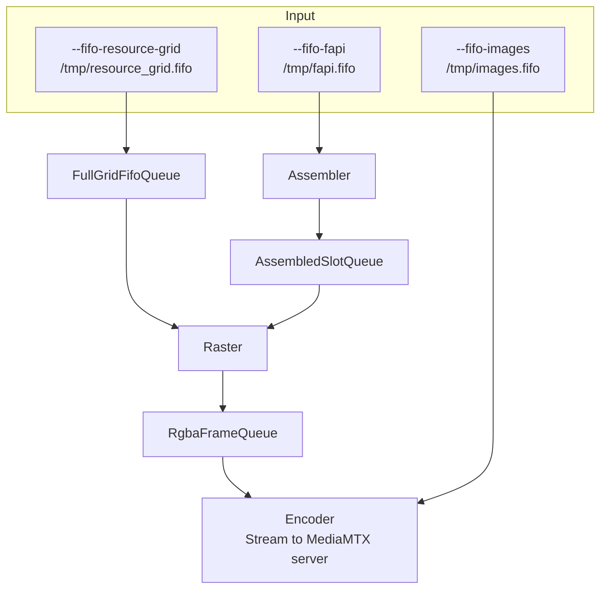

# `resgrid_plotter`

CUDA pipeline that turns I/Q resource grids (or raw RGBA) into **H.264** and pushes **RTSP** via a child **FFmpeg** process (`h264_nvenc` by default, or `libx264` with `--video-encoder cpu`).

**Deployment stance (this repo):** drive video from **named pipes**—**`--fifo-images`** (raw RGBA), **`--fifo-resource-grid`** (full-grid / sidecar I/Q), and **`--fifo-fapi`** (slot messages). The FastAPI backend starts the **IQ** plotter with **all three** flags and creates the corresponding named pipes (see `backend/app/main.py`). **generator.py**, OAI, or other writers can attach to any pipe; the encoder muxes **RGBA from the raster queue** and **optional RGBA from `--fifo-images`** onto FFmpeg stdin (one lock). Do **not** rely on in-process synthetic I/Q for demos or production. The binary still contains a legacy **no-IQ-FIFO** internal loop for bare `resgrid_plotter` bring-up only; that path is **out of scope** for the resource-grid visualizer.

The plotter does not take a numeric mode—it wires each enabled FIFO to a fixed stage. **`CUDA_PLOTTER_DATA_MODE`** may still influence other backend bookkeeping; for IQ video the FastAPI stack passes **all** FIFO CLI flags when it spawns `resgrid_plotter`.

## Pipeline

**FIFO paths (Input):** if you pass **`--fifo-images`**, **`--fifo-resource-grid`**, or **`--fifo-fapi`** without a following `PATH` token, the plotter uses the same paths as FastAPI (`backend/app/main.py`):

| CLI flag | Named pipe | Typical backend env |
|----------|--------------------|---------------------|
| **`--fifo-images`** | `/tmp/images.fifo` | `RESGRID_FIFO_IMAGES` |
| **`--fifo-resource-grid`** | `/tmp/resource_grid.fifo` | `CUDA_IQ_FIFO_PATH` |
| **`--fifo-fapi`** | `/tmp/fapi.fifo` | `CUDA_SLOT_FIFO_PATH` |

In the pipeline diagram, **Input** uses Mermaid **same-rank** syntax (`&`) so the three nodes stay **left to right**: **`--fifo-images`**, **`--fifo-resource-grid`**, **`--fifo-fapi`** (some renderers ignore `direction LR` inside a `TB` graph when edges leave the subgraph).

**FastAPI IQ spawn** passes **`--fifo-images`** (same path as **`RESGRID_FIFO_IMAGES`**) together with **`--fifo-resource-grid`** and **`--fifo-fapi`**. **`--fifo-images` alone** (no IQ FIFOs) selects the encoder-only fast path. For bare **`resgrid_plotter`**, any non-empty subset of the three FIFO argv groups is valid; the RGBA-only shortcut applies only when there are **no** IQ FIFO paths.

| Entry | What runs |
|-------|-----------|
| **`--fifo-images`** only | **Input** (`/tmp/images.fifo`) → **Encoder** only (skips Assembler, Raster, and Capturer). A dedicated thread reads **raw RGBA** from the FIFO and writes **FFmpeg** stdin → **H.264 RTSP** (`plotter_management.cu`). |
| **`--fifo-resource-grid`** + **`--fifo-fapi`** (± **`--fifo-images`**) | **Input** → **`FullGridFifoQueue`** / sidecar when resource-grid is set; **Assembler** when FAPI is set → **`AssembledSlotQueue`** → **Raster** → **Encoder** (optional second thread from **`--fifo-images`**). Optional **Capturer**. |
| **`--fifo-fapi`** without **`--fifo-resource-grid`** | **Input** → **Assembler** → **`AssembledSlotQueue`** → **Raster** → **Encoder** → RTSP. Optional **Capturer**. |

### IQ path (how FIFOs wire)

* **`--fifo-images`** (with IQ FIFOs): optional **second** RGBA stream into the same **EncoderStage** as the raster queue (serialized writes to FFmpeg stdin).
* **`--fifo-resource-grid`**: **Raster** runs a **FIFO reader thread** (full-grid or slot-IQ wire format) into **`FullGridFifoQueue`**, plus the existing **consumer thread** that **`acquire_frame_for_interpolate`** → **`render_frame_rgba`**. (FAPI + same FIFO for I/Q sidecar still uses the assembler’s sidecar reader thread.)
* **`--fifo-fapi`**: slot FIFO → **`slot_message_assembler`** → **`AssembledSlotQueue`** (`GridFrame`s with PHY / allocation metadata) → **Raster** consumes **`AssembledSlotQueue`**, then the same **`acquire_frame`** / CUDA path.
* **Neither IQ FIFO** (legacy): internal synthetic producer → `InternalFrameQueue`. **Out of scope** for this repo—the FastAPI backend always passes **resource-grid + FAPI + images** argv for IQ video.



## Requirements

* **CUDA** toolkit matching your GPU (CMake uses `find_package(CUDAToolkit)`).
* **FFmpeg** on `PATH` with RTSP and the chosen encoder (NVENC or x264).
* **Linux** build links `librt` for shared memory timing (`--cuda-shm`).

## Build

```bash
cd resource-grid-visualizer/backend/plotter
cmake -S . -B build -DCMAKE_BUILD_TYPE=Release
cmake --build build -j"$(nproc)"
# binary: build/resgrid_plotter
```

Default GPU architectures are set in `CMakeLists.txt` (`CUDA_ARCHITECTURES`); override with `-DCMAKE_CUDA_ARCHITECTURES=native` (or a list) if needed.

## Docker

```bash
docker build -t resgrid-plotter .
# default CMD matches a typical MediaMTX URL; override at run time
```

## Inputs (no `--data-mode`)

| Flag | Injects into | Notes |
|------|----------------|-------|
| **`--fifo-images`** | FFmpeg stdin path | Raw RGBA frames (optional **`PATH`**; default **`/tmp/images.fifo`**). With IQ FIFOs: second encoder input muxed with raster RGBA. **Encoder-only** fast path when it is the **only** input FIFO. |
| **`--fifo-resource-grid`** | resource-grid FIFO → **`FullGridFifoQueue`** (raster FIFO thread) → raster CUDA | Optional **`PATH`**; default **`/tmp/resource_grid.fifo`**. **`--fifo-resource-grid-mode full`**: one read = one raw float32×2 full grid. **`slot`**: framed slot-IQ stream (no **`--fifo-fapi`**). With **`--fifo-fapi`**: sidecar full-grid I/Q (see `plotter_pipeline.cu`). |
| **`--fifo-resource-grid-mode`** | (resource-grid FIFO only) | `full` (default) or `slot`. |
| **`--fifo-fapi`** | Slot assembler → `AssembledSlotQueue` | PHY / allocation patches; optional **`PATH`** (default **`/tmp/fapi.fifo`**). |
| *(no IQ FIFO flags)* | Internal synthetic (legacy) | **Unsupported** for this project when using the FastAPI stack—IQ spawns pass **resource-grid + FAPI + images**. |

### Encoder pacing (sparse slot timelines)

If **`--fifo-fapi`** is in use, or standalone **`--fifo-resource-grid-mode slot`**, encoder ticks with **no new RGBA** do **not** inject synthetic black frames; FFmpeg waits on stdin for the next real frame.

## Encode policy (`--encode-policy`)

* **`last`** (default): each encoder tick sends the latest completed RGBA (subsample in time).
* **`mean`**: each tick sends per-pixel mean in linear RGB (then sRGB OETF); incompatible with the **`--fifo-images` encoder-only** fast path (no IQ FIFOs).
* **`ffmpeg`** / **`ffmpeg-filter`**: push rendered frames at `--fps` (capped 600) and let FFmpeg `-vf fps=<encoder-fps>` thin before NVENC.

## Useful flags (abbreviated)

| Flag | Notes |
|------|-------|
| `--rtsp URL` | Default `rtsp://127.0.0.1:8554/live`. |
| `--prb`, `--symbols`, `--cell-pixels` | Grid geometry and cell size in pixels. |
| `--fps` | Producer / pacing hint; with FIFO-only operation, upstream writers and **`--encoder-fps`** dominate cadence. |
| `--encoder-fps` | Paced output for `last` / `mean` (hard-capped at 50 in code). |
| `--queue-depth` | In-process queue depth (env `CUDA_IQ_QUEUE_DEPTH` in the app). |
| `--raster-threads` | CUDA worker threads (default 16, max 64). |
| `--cuda-shm NAME` | POSIX shared memory for FPS / pattern / capturer handoff. |
| `--capturer-dir` | Optional JPEG snapshot pipeline parallel to RTSP. |
| `--fifo-resource-grid-mode` | `full` or `slot` | Standalone resource-grid wire format (see `ResourceGridSlotIqHdr` in `plotter_common.cuh`). |

Full usage text: `resgrid_plotter --help`.

## Source layout

| Path | Role |
|------|------|
| `src/plotter_management.cu` | CLI, SHM map, FIFO wiring, main orchestration. |
| `src/plotter_assembler.cu` | Slot assembler, FIFO readers, internal synthetic producer. |
| `src/plotter_raster.cu` | Frame acquisition order, CUDA raster, pool merger. |
| `src/plotter_encoder.cu` | FFmpeg child, stdin pacing, `--fifo-images` feeder. |
| `src/plotter_capturer.cu` | Optional disk JPEG writer. |
| `include/plotter_common.cuh` | Queues, wire structs, SHM offsets, shared declarations. |
