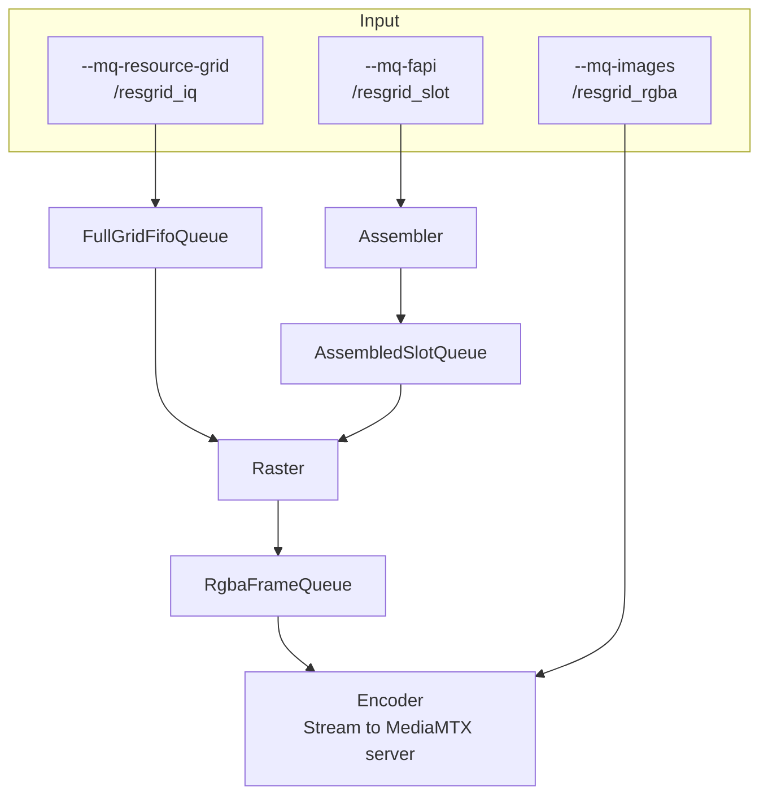

# `resgrid_plotter`

CUDA pipeline that turns I/Q resource grids (or raw RGBA) into **H.264** and pushes **RTSP** via a child **FFmpeg** process (`h264_nvenc` by default, or `libx264` with `--video-encoder cpu`).

**Deployment stance (this repo):** drive video from **POSIX message queues** — **`--mq-images`** (raw RGBA), **`--mq-resource-grid`** (full-grid / sidecar I/Q), and **`--mq-fapi`** (slot messages). Queue names must start with **`/`** (e.g. `/resgrid_rgba`). The FastAPI backend creates each queue (see `backend/app/main.py` + `backend/app/resgrid_posix_mq.py`), spawns **resgrid_plotter** with the **`--mq-*`** flags, and starts **generator.py** with the same **`--mq-*`** spellings.

### Chunked wire format (all three mq inputs)

Each **logical** frame (one RGBA image, one full-grid I/Q blob, or one slot message byte string) may span **multiple** `mq_send` messages. Every mq message begins with a **little-endian** chunk header: **24 bytes** for **`version == 1`**, or **28 bytes** for **`version == 2`** (current Python / C++ producers use v2). Fields:

| Field | Type | Meaning |
|-------|------|--------|
| `magic` | `uint32` | `0x52474D43` (`'RGMC'`) |
| `version` | `uint32` | `1` (legacy) or `2` (adds `prb` / `symbols`) |
| `frame_seq` | `uint32` | Increments per **logical** frame (writer responsibility) |
| `chunk_idx` | `uint16` | `0 … n_chunks-1` |
| `n_chunks` | `uint16` | Total chunks for this logical frame |
| `logical_len` | `uint32` | Total payload bytes for the frame |
| `byte_off` | `uint32` | Offset of this chunk’s payload within the reassembled frame |
| `prb` | `uint16` | *(v2 only)* PRB count for full-grid I/Q payloads; `0` if unknown or non-grid |
| `symbols` | `uint16` | *(v2 only)* Symbol count for full-grid I/Q; `0` if unknown or non-grid |

Payload follows the header in the same mq message. The reader reassembles chunks in order (same semantics as a byte stream on a pipe). Match **`RESGRID_MQ_MSGSIZE`** / **`RESGRID_MQ_MAXMSG`** between producers and the plotter host limits (`/proc/sys/fs/mqueue/*`); defaults follow the C++ helper `plotter_posix_mq.cpp`.

## Pipeline

**MQ paths (input):** if you pass **`--mq-images`**, **`--mq-resource-grid`**, or **`--mq-fapi`** without a following `NAME` token, the plotter uses the same names as FastAPI (`backend/app/main.py`):

| CLI flag | Default mq name | Typical backend env |
|----------|-----------------|---------------------|
| **`--mq-images`** | `/resgrid_rgba` | `RESGRID_MQ_IMAGES` |
| **`--mq-resource-grid`** | `/resgrid_iq` | `CUDA_IQ_MQ_PATH` |
| **`--mq-fapi`** | `/resgrid_slot` | `CUDA_SLOT_MQ_PATH` |

**FastAPI IQ spawn** passes **`--mq-images`**, **`--mq-resource-grid`**, and **`--mq-fapi`** (names from env). **`--mq-images` alone** (no IQ queues) selects the encoder-only fast path. For bare **`resgrid_plotter`**, any non-empty subset of the three argv groups is valid.

| Entry | What runs |
|-------|-----------|
| **`--mq-images`** only | **Input** → **Encoder** only (skips Assembler, Raster, Capturer). Thread reads mq → FFmpeg stdin → RTSP. |
| **`--mq-resource-grid`** + **`--mq-fapi`** (± **`--mq-images`**) | **Input** → **`FullGridFifoQueue`** / sidecar + **Assembler** → **`AssembledSlotQueue`** → **Raster** → **Encoder** (optional second thread from **`--mq-images`**). |
| **`--mq-fapi`** without **`--mq-resource-grid`** | **Input** → **Assembler** → **`AssembledSlotQueue`** → **Raster** → **Encoder** → RTSP. |

### IQ path (how queues wire)

* **`--mq-images`** (with IQ queues): optional second RGBA stream into **EncoderStage**.
* **`--mq-resource-grid`**: **Raster** mq reader thread → **`FullGridFifoQueue`**, plus assembler sidecar when FAPI is enabled.
* **`--mq-fapi`**: slot mq → **`slot_message_assembler`** → **`AssembledSlotQueue`**.
* **Neither IQ queue** (legacy): internal synthetic producer — **out of scope** for FastAPI demos.



## Requirements

* **CUDA** toolkit matching your GPU (CMake uses `find_package(CUDAToolkit)`).
* **FFmpeg** on `PATH` with RTSP and the chosen encoder (NVENC or x264).
* **Linux** build links `librt` for POSIX mq + shared memory timing (`--cuda-shm`).

## Build

```bash
cd resource-grid-visualizer/backend/plotter
cmake -S . -B build -DCMAKE_BUILD_TYPE=Release
cmake --build build -j"$(nproc)"
# binary: build/resgrid_plotter
```

Default GPU architectures are set in `CMakeLists.txt` (`CUDA_ARCHITECTURES`); override with `-DCMAKE_CUDA_ARCHITECTURES=native` (or a list) if needed.

## Docker

```bash
docker build -t resgrid-plotter .
# default CMD matches a typical MediaMTX URL; override at run time
```

## Inputs (no `--data-mode`)

| Flag | Injects into | Notes |
|------|----------------|-------|
| **`--mq-images`** | FFmpeg stdin path | Raw RGBA logical frames (chunked mq). Optional **`NAME`**; default **`/resgrid_rgba`**. Encoder-only when sole IQ input. |
| **`--mq-resource-grid`** | Full-grid / sidecar stream → **`FullGridFifoQueue`** | Optional **`NAME`**; default **`/resgrid_iq`**. **`--mq-resource-grid-mode`**: `full` or `slot` (standalone). With **`--mq-fapi`**: sidecar full-grid. |
| **`--mq-fapi`** | Slot assembler | Default **`/resgrid_slot`**. |
| *(no IQ mq flags)* | Internal synthetic (legacy) | Unsupported for FastAPI IQ video. |

### Encoder pacing (sparse slot timelines)

If **`--mq-fapi`** is in use, or standalone **`--mq-resource-grid-mode slot`**, encoder ticks with **no new RGBA** do **not** inject synthetic black frames.

## Encode policy (`--encode-policy`)

* **`last`** (default): each encoder tick sends the latest completed RGBA.
* **`mean`**: per-pixel mean in linear RGB; incompatible with **encoder-only** **`--mq-images`** path.
* **`ffmpeg`** / **`ffmpeg-filter`**: push at `--fps`, FFmpeg `-vf fps=<encoder-fps>` before NVENC.

## Useful flags (abbreviated)

| Flag | Notes |
|------|-------|
| `--rtsp URL` | Default `rtsp://127.0.0.1:8554/live`. |
| `--prb`, `--symbols`, `--cell-pixels` | Grid geometry and cell size in pixels. |
| `--fps` | Producer / pacing hint; upstream writers and **`--encoder-fps`** dominate cadence. |
| `--encoder-fps` | Paced output for `last` / `mean` (hard-capped at 50 in code). |
| `--queue-depth` | In-process queue depth (env `CUDA_IQ_QUEUE_DEPTH` in the app). |
| `--raster-threads` | CUDA worker threads (default 16, max 64). |
| `--cuda-shm NAME` | POSIX shared memory for FPS / pattern / capturer handoff. |
| `--capturer-dir` | Optional JPEG snapshot pipeline parallel to RTSP. |
| `--mq-resource-grid-mode` | `full` or `slot` | Standalone resource-grid wire format (`ResourceGridSlotIqHdr` in `plotter_common.cuh`). |

Full usage text: `resgrid_plotter --help`.

## Source layout

| Path | Role |
|------|------|
| `src/plotter_management.cu` | CLI, SHM map, mq argv wiring, main orchestration. |
| `src/plotter_posix_mq.cpp` | POSIX mq create / chunked send / `ResgridMqStreamIn` read path (plain C++). |
| `src/plotter_assembler.cu` | Slot assembler, mq readers, internal synthetic producer. |
| `src/plotter_raster.cu` | Frame acquisition order, CUDA raster, pool merger. |
| `src/plotter_encoder.cu` | FFmpeg child, stdin pacing, `--mq-images` feeder. |
| `src/plotter_capturer.cu` | Optional disk JPEG writer. |
| `include/plotter_common.cuh` | Queues, wire structs, SHM offsets, shared declarations. |
| `include/plotter_posix_mq.cuh` | Chunk header + `ResgridMqStreamIn` declaration. |
