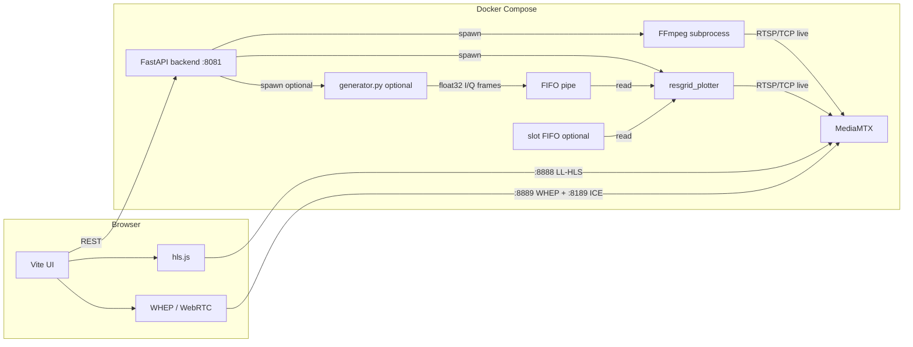

# Resource grid — architecture and operations

This stack can publish to **[MediaMTX](https://github.com/bluenviron/mediamtx)** over **RTSP** in two ways: **synthetic video** (FastAPI + FFmpeg `lavfi`) or **synthetic I/Q** (**`resgrid_plotter`** subprocess: CUDA magnitude + Viridis + NVENC, shipped inside the **backend** image). Optionally, I/Q **samples** are generated in Python at **`CUDA_IQ_GEN_FPS`** (default **200 Hz**) and sent through a **named FIFO**; the **encoder** runs at **`CUDA_IQ_FPS`** (default **24 Hz**). If **GEN > IQ** the FIFO provides **backpressure** so sustained encode stays near **CUDA_IQ_FPS**. The **Vite** UI plays **WebRTC (WHEP)** by default or **LL-HLS** when configured (`VITE_PLAYBACK_MODE=hls` or `?playback=hls`) from MediaMTX.

**Integrators (channel ids, slot FIFO layout, grid indexing):** see **[`docs/CHANNEL_BASED_INTERFACE.md`](CHANNEL_BASED_INTERFACE.md)**.

---

## High-level diagram



**Dual DL/UL** (`compose/docker-compose.dlul.yaml`): same diagram with **two** FastAPI processes (**`:8081`** downlink, **`:8082`** uplink); Vite uses **`VITE_API_BASE_DL`** / **`VITE_API_BASE_UL`**; MediaMTX paths **`live_dl`** / **`live_ul`** (see **Configuration reference**).

- **Subscribers** (HLS/WebRTC) talk to **MediaMTX** directly; the API provides playback URLs and documents **generation mode** (`SYNTHETIC_IMAGES`, **`SYNTHETIC_RESOURCE_GRID`**, or **`SYNTHETIC_FAPI`**). Legacy spellings **`SYNTHETIC_VIDEO`**, **`SYNTHETIC_IQ`**, and **`SYNTHETIC_CHANNEL_BASED`** are still accepted in env and REST bodies. Legacy **`CHANNEL_BASED_SYNTHETIC_GENERATION`** is still accepted as an alias for **slot-message / channel-based** mode (env + REST).
- **Who publishes `live`:** either backend **FFmpeg** (video mode) or **`resgrid_plotter`** (IQ mode) — **not both** at once.
- **FIFO path** (`CUDA_IQ_USE_FIFO=1`): Python writes **raw interleaved `float32` I/Q** (re, im per cell, same layout as CUDA’s former in-process producer). CUDA opens the FIFO for read, runs the GPU path and NVENC **once per read frame**, at **`CUDA_IQ_FPS`** for FFmpeg.
- **Slot FIFO** (**slot-message** / channel-based path, `SYNTHETIC_CHANNEL_BASED` → `resgrid_plotter --data-mode 3`): named pipe carrying **per-slot allocation messages** (each message updates a **patch** of the resource grid, not necessarily the whole grid). Completed slots are fed into the **same** encode path with **priority** over the IQ FIFO for that iteration (see **Path C** below). **`CUDA_SLOT_USE_FIFO`** does **not** enable this on **full-grid FIFO** (`--data-mode 2`); use channel-based mode or **`CUDA_PLOTTER_DATA_MODE=3`**.

---

## Components

| Piece | Role |
|--------|------|
| **MediaMTX** | RTSP ingest (`:8554`), HTTP LL-HLS (`:8888`), WebRTC / WHEP (`:8889` + ICE on `:8189` tcp/udp). Config: `mediamtx/mediamtx.yml`. |
| **Backend** | FastAPI + **`SYNTHETIC_VIDEO`** (FFmpeg `lavfi`), **`SYNTHETIC_IQ`**, or **`SYNTHETIC_CHANNEL_BASED`** (**`resgrid_plotter`**: CUDA magnitude / channel tints + NVENC). Same RTSP `live` path — only one active at a time. |
| **`generator.py`** | Optional **Python 3** script (`backend/scripts/`). Writes full-grid I/Q to **`--fifo-resource-grid`**, FAPI/slot demos to **`--fifo-fapi`**, at **`CUDA_IQ_GEN_FPS`** (default **200**) where applicable. Encoder (**`CUDA_IQ_FPS`**, default **24**) may be lower — writers block when the pipe fills. |
| **Frontend** | Vite UI (`ResgridPanel` per column); publisher mode selector (selection only); **Start** / **Stop** send chosen mode in JSON; IQ mode shows **PRB / symbol** axes when active. With **`VITE_API_BASE_DL`** + **`VITE_API_BASE_UL`**, two side-by-side panels talk to two backends unless **`VITE_GUI_COMBINE=1`** forces a single column. **`VITE_GUI_DLUL=1`** requests two columns when both API bases are set (see **`.env.example`**). Single-stack Docker sets **`VITE_API_RELATIVE`** + dev-server **proxy** so the browser can use one origin (**`:5173`**). |

### Generation modes (`GENERATION_MODE`)

Default when **`GENERATION_MODE`** is unset: **`synthetic_channel_based`** → **`SYNTHETIC_FAPI`** (**slot messages** / channel-based, **`--data-mode 3`**): **`resgrid_plotter`** with **slot FIFO** always enabled. **Video resembles full-grid FIFO** (same synthetic I/Q and Viridis) until slot messages paint **`chan`** **1…8** (OAI emits **7**/**8** when CSI-RS/SRS are scheduled); PHY/RNTI overlays need a slot writer.

- **`SYNTHETIC_VIDEO`** — Backend FFmpeg + `lavfi` (see `LAVFI_VIDEO`). **Start** / **Stop** drive this process; JSON body may include `mode` (optional; must match selection for clarity).
- **`SYNTHETIC_IQ`** — Backend spawns **`resgrid_plotter`**: **built-in** synthetic I/Q (**`--data-mode 1`**) when **`CUDA_IQ_USE_FIFO=0`**; **full-grid IQ FIFO** (**`--data-mode 2`**) + **`generator.py`** when **`CUDA_IQ_USE_FIFO=1`**. Rebuild backend after editing **`backend/plotter/`** or **`backend/scripts/`**.
- **`SYNTHETIC_CHANNEL_BASED` (slot messages / channel-based, `--data-mode 3`)** — Same binary and RTSP path. Backend **always** creates slot FIFO + **`--fifo-fapi`**. **Builtin I/Q** (patterns **0…3**) and **encode cadence** are unchanged vs full-grid mode when **`CUDA_IQ_USE_FIFO=0`**; **slot records** supply **partial** grid updates plus **`chan`**, RNTI, and slot header labels.

---

## Media path (publisher)

### Synthetic video mode

1. **Source:** FFmpeg reads `lavfi` (default: 1280×720 @ 30 fps `testsrc`; `LAVFI_VIDEO` env for e.g. `mandelbrot` — heavy patterns may not reach 1.0× speed).
2. **Encode:** `h264_nvenc` when `VIDEO_ENCODER=nvenc`, else `libx264` (tuned for low latency / regular keyframes for LL-HLS).
3. **Mux:** Video-only RTSP (`-an`) over **TCP** into MediaMTX path `live` (see `MTX_RTSP_URL`).
4. **Startup:** The backend calls **`stop_publishers()`** once on boot (idle first), then if **`AUTO_START=1`** starts the active-mode publisher (`FFmpeg` when **`GENERATION_MODE=SYNTHETIC_IMAGES`** and the legacy path applies, **`resgrid_plotter`** when **`SYNTHETIC_RESOURCE_GRID`** or **`SYNTHETIC_FAPI`**). **`compose/docker-compose*.yml`** defaults **`AUTO_START` to `0`** (idle until **Start** in the UI or **POST /api/generator/start** / **POST /api/plotter/start**); set **`AUTO_START=1`** in the environment for auto-start on boot. The Python process also defaults to **`0`** if the variable is unset.

### Synthetic IQ mode (`resgrid_plotter`)

**Pipeline detail** (current fused loop; **target** **Assembly / Raster / Encode** in *Target architecture*): [`docs/PLOTTER_PIPELINE.md`](PLOTTER_PIPELINE.md).

**Output:** Square (default) or rectangular heatmap (Viridis on magnitude); **horizontal axis = symbol index**, **vertical = PRB** (**PRB 0 at bottom**); FFmpeg **rawvideo RGBA** → **NVENC** → RTSP `live`. Flags: **`--no-square`**, **`--square-letterbox`**; **`--fifo-resource-grid PATH`** reads I/Q from a FIFO instead of the built-in C++ producer thread. Before NVENC, the plotter may **pad** the buffer to at least **128×128** and **round up** to **16-pixel** boundaries (centers content) so **`h264_nvenc`** accepts the frame on stricter GPUs.

**Path A — Built-in (default, `CUDA_IQ_USE_FIFO=0`)**

1. **Producer thread** (only when **`CUDA_IQ_USE_FIFO=0`**) supplies a synthetic **I/Q** grid (shared-memory **pattern 0…3**: waves, single tone, Gaussian blob, vortex); **`chan` stays zero** unless slot completions override. With **`CUDA_IQ_USE_FIFO=1`**, **`generator.py`** writes the same pattern range; FIFO carries I/Q only (no `chan`). **`resgrid_plotter`** rasterizes magnitude/tint to RGBA, then **CPU region centroid overlays** **before** NVENC.
2. **CUDA:** magnitude → **block (index-based)** upscale to frame size; **Viridis** where `channel==0` (magnitude-driven), else a **flat PHY tint** per channel id **1…8** (independent of magnitude) → **RGBA**; **D2H** copy.
3. **Host overlays (before NVENC stdin):** for each PHY id **1…8** present in the cell **`chan` plane**, draw a **two-line** label (**PHY** name + **RNTI** as **`0x` hex**) at the **centroid** of each **4-connected** region where **`chan` and `cell_rnti` match along edges** (so distinct RNTIs split labels on **every** logical PHY channel); when **`cell_rnti`** is absent, PHY name only. CUDA uses the same **`cell_rnti`** plane for a subtle per-RNTI tint on ids **1…8**. Skipped when all **`chan`==0**.
4. **FFmpeg** child: stdin **RGBA** → **`h264_nvenc`** → RTSP/TCP. The main loop **renders** every acquired grid at up to the producer/FIFO rate (**encoder input**). **stdin writes** are **paced** to **`--encoder-fps`**: intermediate RGBA frames are **dropped** (latest retained) so real-time output stays near the target; FFmpeg’s **`fps=`** progress line reflects **stdin** rate (~encoder).

**Path B — FIFO + Python (`CUDA_IQ_USE_FIFO=1`)**

1. **Backend** creates **`CUDA_IQ_FIFO_PATH`** (default `/tmp/resource_grid.fifo`) with `mkfifo`, then **`chmod 0666`** and optional **`chown`** (see **`RESGRID_FIFO_CHOWN`** in the env table), then starts **`resgrid_plotter … --fifo-resource-grid <path>`**. The process **opens the FIFO for read** and blocks until a writer exists.
2. **Backend** starts **`generator.py`** only when **`CUDA_AUTO_START_IQ_GENERATOR=1`**; otherwise use **POST /api/generator/start** with **`{"feed":"resource_grid"}`** or **`{"feed":"fapi"}`** (or an external writer). Script args: `--fifo-resource-grid` (alias `--fifo`), `--prb`, `--symbols`, **`--fps CUDA_IQ_GEN_FPS`** (default **200**); slot demos also get **`--slot-window-min-prb`** from **`CUDA_SLOT_WINDOW_MIN_PRB`**. Each write is **`prb * symbols * 2 * 4`** bytes (`float32` re, im; layout matches CUDA `s * prb + p`).
3. **CUDA** pulls **one full grid** per loop iteration (FIFO or queue), runs magnitude / colormap / overlays every time (**up to `CUDA_IQ_GEN_FPS`**), and **writes stdin** at **`CUDA_IQ_FPS`** (latest RGBA per slot).

**Path C — Slot allocation FIFO (`--fifo-fapi PATH`; **slot-message** / channel-based, `SYNTHETIC_CHANNEL_BASED` / `--data-mode 3`)**

1. **Backend** creates **`CUDA_SLOT_FIFO_PATH`** (default `/tmp/fapi.fifo`) with `mkfifo` when starting CUDA in **channel-based** mode (or when **`CUDA_PLOTTER_DATA_MODE=3`**), then **`chmod`** / optional **`chown`** like the IQ FIFO, and passes **`--fifo-fapi`** (optionally with an explicit path; plotter default matches) to **`resgrid_plotter`**.
2. **Wire format:** Each record is a **40-byte little-endian header** (magic `0x31564153`, version **1** or **2**) optionally followed by **`n_complex × 8`** bytes of interleaved **`float32` I/Q**. **`n_complex = 0`** with non-zero **`sym_count` / `prb_count`** denotes **shape-only**: no I/Q bytes; **`channel` / `rnti`** paint flat PHY colors (see **`docs/CHANNEL_BASED_INTERFACE.md`**). When **`n_complex > 0`**, it must match the rectangle (or v2 multi sum) and the full payload must follow.
3. **Semantics:** For each **new `slot_id`**, the previous slot grid is **finalized**. A fresh grid is **zeroed**, then each message **scatters** optional I/Q payload into the rectangle and always updates **`channel` / `rnti`** for that patch.
4. **Encode loop priority:** If a completed slot frame is queued, it is consumed **before** reading **`--fifo-resource-grid`** or the built-in synthetic queue for that iteration. Each slot message’s **`channel`** byte fills the per-cell tint plane (ids **1…8**; **0** → Viridis). Overlapping writes in one slot: **last write wins**. Sidecar reads supply **I/Q only**; the plotter **reapplies the last slot’s** `chan` / per-cell **RNTI** on those frames so tint does not alternate with Viridis at the IQ rate. Non-monotonic **`slot_id`** (decrease) → message dropped (logged). **Completed slot frames** are composited as usual; **region centroid labels** (see Path A step 3) run for every non-zero **`chan`** plane **before** NVENC.
5. **Shutdown:** The slot reader thread **flushes** the open slot (pushes its grid once) when the FIFO closes or the process exits.

**Rate / backpressure:** Defaults: **`CUDA_IQ_GEN_FPS=200`**, **`CUDA_IQ_FPS=24`**. The plotter can **CUDA-render** faster than **NVENC** output; bounded **`GridFrame`** / **RGBA** queues **drop oldest** when full so producers are not stalled by a slow encoder, and the heatmap on air **samples** the latest grids at the encoder rate.

**Shutdown:** **Stop** (or API teardown) terminates the **Python producer first** (closes the write end), then **`resgrid_plotter`**.

### File capturer (JPEG stills, parallel to NVENC)

When **`RESGRID_CAPTURER_DIR`** is set (legacy alias **`RESGRID_ENCODER_SNAP_DIR`**), the backend passes **`--capturer-dir`** to **`resgrid_plotter`**. Each **raster** RGBA is still pushed to the **video** encoder queue as usual; in **parallel**, a copy may be queued for **JPEG** workers that write **`frame_*.jpg`** under a session directory.

- **REST:** **`POST /api/plotter/capturer`** with body **`{"frames": N}`** (optional **`frames`**: default **2000**). **`POST /api/plotter/capturer/stop`** caps the session at frames already accepted and drains the queue. OpenAPI: **`GET …/docs`**.
- **Limits:** Requests above **`RESGRID_CAPTURER_MAX_FRAMES`** (if set), else **`RESGRID_ENCODER_CAPTURE_MAX_FRAMES`** (default **20000**), return **400**.
- **Backpressure:** The capturer uses a **bounded** in-memory queue with **drop-oldest** when full so slow disk or JPEG work does **not** block the raster thread. Worker count: env **`RESGRID_CAPTURE_JPEG_THREADS`** (see plotter logs / SHM).
- **Control plane:** Session **path**, **frame count**, **phase**, and progress occupy the **tail** of the CUDA IQ SHM object (**384 bytes** total; see [`PLOTTER_PIPELINE.md`](PLOTTER_PIPELINE.md) §9).

**Image build:** `backend/Dockerfile` multi-stage: **`backend/plotter/`** → `resgrid_plotter`, then runtime stage copies **`backend/scripts/`** and **`backend/app/`**.

---

## Playback paths (subscriber)

| Mode | Default in compose | Ports | Notes |
|------|--------------------|-------|-------|
| **WebRTC (WHEP)** | Yes (`VITE_PLAYBACK_MODE=webrtc` or unset in dev) | `8889/tcp`, `8189/tcp+udp` | Lowest latency; may need `MTX_WEBRTC_ADDITIONAL_HOSTS` so remote browsers get a routable ICE candidate. |
| **LL-HLS** | Opt-in (`VITE_PLAYBACK_MODE=hls` or `?playback=hls`) | `8888/tcp` | TCP-only; segments + parts configured for low latency in `mediamtx.yml`. |

---

## Ports (from `compose/docker-compose.yml`)

| Port | Service | Purpose |
|------|---------|---------|
| 5173 | Frontend | Vite UI; single-stack compose also **proxies** **`/api`**, **`/docs`**, **`/openapi.json`**, **`/redoc`** to the backend (**`VITE_DEV_PROXY_TARGET`**) so LAN clients can use **:5173** only. |
| 8081 | Backend | FastAPI (single-stack default) |
| 8082 | Backend (UL only) | Second FastAPI when using **`compose/docker-compose.dlul.yaml`** |
| 8554 | MediaMTX | RTSP (publisher + optional external publishers) |
| 8888 | MediaMTX | HTTP / HLS |
| 8889 | MediaMTX | WHEP / WHIP HTTP |
| 8189 | MediaMTX | WebRTC ICE (TCP + UDP) |

Open the LAN firewall for the modes you use (HLS: typically `8888`; WebRTC: also `8889` and `8189`).

---

## Backend API (summary)

| Method | Path | Purpose |
|--------|------|--------|
| `GET` | `/health` | Liveness; includes `generating`. |
| `GET` | `/api/plotter/status` | CUDA **resgrid_plotter** pipeline: encoder label, IQ SHM rates, JPEG capturer, etc. (no separate **generator.py** process rows). |
| `GET` | `/api/generator/status` | Process **`generation_mode`** plus **`synthetic_video`** (RGBA FIFO / FFmpeg), **`synthetic_resource_grid`**, and **`synthetic_fapi`** (**generator.py** on IQ / slot pipes). |
| `GET` | `/api/plotter/playback` | `hls` + `webrtc_whep` URLs; MediaMTX HTTP host inferred from **`Origin` / `Referer`**, **`X-Forwarded-Host`**, **`Host`**, request URL, else **`MTX_PUBLIC_HTTP_BASE`**. |
| `POST` | `/api/generator/start` | Start **generator.py**: JSON **`feed`** (**`images`** \| **`resource_grid`** \| **`fapi`**); optional **`images`** for RGBA FIFO (**`pattern`** / **`preset`**). |
| `POST` | `/api/generator/stop` | Stop FFmpeg lavfi, RGBA FIFO **generator.py**, and IQ/slot **generator.py**; leaves CUDA plotter running. |
| `POST` | `/api/stop` | Stop **FFmpeg** and/or **CUDA plotter** (full publisher teardown). |
| `POST` | `/api/plotter/start` | Start **`resgrid_plotter`**. Spawn args come from env (FIFO paths, **`CUDA_PLOTTER_DATA_MODE`**); optional JSON **`mode`** / **`encoder_fps`**. |
| `POST` | `/api/plotter/stop` | Stop **`resgrid_plotter`** only; use **`POST /api/generator/stop`** or **`POST /api/stop`** if you also need generator teardown. |
| `GET`/`PUT` | `/api/generator/fps` | IQ generator commanded FPS (SHM / override). |
| `GET` | `/api/generator/patterns` | Pattern catalog. |
| `PUT` | `/api/generator/pattern` | Set synthetic IQ pattern. |
| `GET` | `/api/generator/channel-legend` | PHY tint legend. |
| `POST` | `/api/plotter/capturer` | Arm **file capturer** (JPEG stills under **`--capturer-dir`**). Body **`frames`** optional (default **2000**). **503** if plotter not running or capturer dir not configured. |
| `POST` | `/api/plotter/capturer/stop` | Request early end of capture session (after frames already taken from raster). |

Open **http://&lt;host&gt;:5173/docs** when using single-stack Docker Compose (**Vite** proxies **`/docs`**, **`/openapi.json`**, **`/redoc`**, **`/api`** to the backend). **`/openapi.json`** is built per request so example HLS links use the same host inference as **`GET /api/plotter/playback`**. Direct: **http://&lt;host&gt;:8081/docs** if **:8081** is reachable.

---

## IQ / FIFO environment variables

| Variable | Default | Meaning |
|----------|---------|---------|
| `RESGRID_CAPTURER_DIR` | *(unset)* | Writable directory inside the container for **`frame_*.jpg`** sessions; enables **`--capturer-dir`**. Legacy: **`RESGRID_ENCODER_SNAP_DIR`**. |
| `RESGRID_CAPTURER_MAX_FRAMES` | *(falls back)* | Hard cap on **`frames`** for **`POST …/capturer`**. If unset, **`RESGRID_ENCODER_CAPTURE_MAX_FRAMES`** is used. |
| `RESGRID_ENCODER_CAPTURE_MAX_FRAMES` | `20000` | Default max **`frames`** per capturer request when **`RESGRID_CAPTURER_MAX_FRAMES`** is unset. |
| `RESGRID_CAPTURE_JPEG_THREADS` | *(plotter default)* | Optional cap on parallel JPEG writer threads in **`resgrid_plotter`** (see C++ env reader). |
| `AUTO_START` | `0` | Compose and code default **off**; `1` = start the publisher after boot (after an initial **`stop_publishers()`**). |
| `CUDA_AUTO_START_IQ_GENERATOR` | `0` | `1` = spawn **`generator.py`** with the CUDA publisher. Default **`0`**: **POST /api/generator/start** with **`iq_scope`**. |
| `CUDA_IQ_USE_FIFO` | `1` | `1` = pass **`--fifo-resource-grid`** to CUDA; Python writer is optional (**`CUDA_AUTO_START_IQ_GENERATOR`** or manual start / external process). Set **`0`** for built-in C++ synthetic I/Q only. |
| `CUDA_IQ_FIFO_PATH` | `/tmp/resource_grid.fifo` | Named pipe path (created on Start). |
| `RESGRID_FIFO_IMAGES` | `/tmp/images.fifo` | When unset in env, backend uses this default RGBA named pipe for **`--fifo-images`** / **`POST /api/generator/start`** with **`mode":"SYNTHETIC_IMAGES"`**. Set to empty string to disable. |
| `CUDA_IQ_QUEUE_DEPTH` | `32` | **`resgrid_plotter --queue-depth`**: in-memory **`GridFrame`** / **RGBA** queue capacity — **not** a file. When full, **`push` drops oldest** (see **`g_*_queue_drops`** counters in plotter sources). See [`CHANNEL_BASED_INTERFACE.md`](CHANNEL_BASED_INTERFACE.md) §2. |
| `CUDA_IQ_GEN_FPS` | `200` | Python generator / SHM “generator FPS” default (Hz); backend passes **`--fps`** to **`resgrid_plotter`**. |
| `CUDA_IQ_FPS` | `24` | NVENC output cadence (Hz); backend passes **`--encoder-fps`** (plotter **`--fps`** alone does not set encode rate if **`--encoder-fps`** is set). |
| `CUDA_IQ_PRB`, `CUDA_IQ_SYMBOLS`, `CUDA_IQ_CELL_PIXELS`, … | see `.env.example` | Grid size and CUDA plotter tuning. Passed to **`resgrid_plotter`** and **`generator.py`** when the backend spawns it. |
| `CUDA_SLOT_WINDOW_MIN_PRB` | `50` | Passed as **`--slot-window-min-prb`** to **`generator.py`** for **`symbol-windows`** (minimum PRB span per symbol; capped by grid width). Generator CLI default also reads this env when **`--slot-window-min-prb`** is omitted. |
| `CUDA_SLOT_USE_FIFO` | `0` | **Ignored** with full-grid FIFO (`--data-mode 2`); log warning. Use **`SYNTHETIC_CHANNEL_BASED`** or **`CUDA_PLOTTER_DATA_MODE=3`** for slot FIFO. |
| `CUDA_SLOT_FIFO_PATH` | `/tmp/fapi.fifo` | FAPI / slot allocation named pipe (created on Start). |
| `RESGRID_FIFO_CHOWN` | `1000:1000` | After **`mkfifo`**, **`chown(uid,gid)`** on IQ/slot pipes when the backend runs as root (typical Docker). Matches sibling containers (e.g. OAI gNB **`user: 1000:1000`**) on a host-mounted **`/tmp`**. Format **`uid:gid`**. |
| `RESGRID_FIFO_CHOWN_DISABLE` | `0` | If **`1`** / **`true`**, skip FIFO **`chown`**. |

**CUDA plotter control SHM** (`--cuda-shm`, **384 bytes**): **0…87** — producer / raster / encoder **rates** and counters (same layout as before: doubles at **0**, **8**, **24**, stage rates **40…80**, **`uint64`** published frames at **32**, pattern at **16**). **88…383** — **file capturer** session (**`uint32`** totals, phase, progress, path, queue stats, stop flag); see [`PLOTTER_PIPELINE.md`](PLOTTER_PIPELINE.md) §9 and **`GET /api/plotter/status`**.

See **`.env.example`** for the full list and comments.

---

## GPU (NVENC) vs CPU

- **Compose** reserves NVIDIA GPUs on the **backend** service (`deploy.resources.reservations.devices`, `driver: nvidia`) and sets `NVIDIA_*` plus `VIDEO_ENCODER=nvenc` by default. In stack **`deploy.resources.limits`**, **`memswap_limit`** is **RAM + swap** combined for the cgroup; values **equal** to **`memory`** give **no** extra swap headroom for that service (not “add N GB of swap on top of RAM”).
- **Host requirements:** proprietary NVIDIA driver and [NVIDIA Container Toolkit](https://docs.nvidia.com/datacenter/cloud-native/container-toolkit/latest/install-guide.html). Verify `nvidia-smi` and `docker run --rm --gpus all nvidia/cuda:12.0.0-base-ubuntu22.04 nvidia-smi`.
- **CPU-only:** Remove the `deploy:` block under `backend`, set `VIDEO_ENCODER=cpu`, and drop `NVIDIA_VISIBLE_DEVICES` / `NVIDIA_DRIVER_CAPABILITIES` if you like (see comments in `compose/docker-compose.yml`). **Synthetic IQ (CUDA)** requires a GPU in this design.

---

## Configuration reference

- **Stack & dev workflow:** `compose/docker-compose.yml` (also `docker compose -f compose/docker-compose.yml watch`).
- **Compose variants (PRB default for `CUDA_IQ_PRB` when unset):**
  | File | Default `CUDA_IQ_PRB` | Notes |
  |------|------------------------|--------|
  | `compose/docker-compose.yml` | **273** | Single backend, path **`live`**. |
  | `compose/docker-compose.bw133.yml` | **133** | Same stack; smaller IQ grid / OAI alignment. |
  | `compose/docker-compose.bw106.yml` | **106** | Same stack; **106** PRB. |
  | `compose/docker-compose.dlul.yaml` | **273** per backend | Two APIs **8081** / **8082**; **`live_dl`** / **`live_ul`**. |
  | `compose/docker-compose.dlul.bw106.yaml` | **106** per backend | DL/UL stack with **106** PRB defaults. |
  | `compose/docker-compose.dlul.bw273.yaml` | **273** per backend | Same DL/UL paths as **`compose/docker-compose.dlul.yaml`**; explicit **273** PRB profile file. |
  Override with **`CUDA_IQ_PRB`** in the environment when you need a value different from the file’s default (DL/UL stacks use the same variable name on each service).
- **Frontend (single-stack compose):** **`VITE_API_RELATIVE=1`** and **`VITE_DEV_PROXY_TARGET=http://backend:8081`** — browser uses only **:5173** for UI + API + Swagger (see **Quick start**). **`VITE_API_BASE`** / **`VITE_API_BASE_*`**: if set to **`localhost`** / **`127.0.0.1`** but you open the UI at a LAN IP, the client rewrites the API host to match the page (**`frontend/src/config/panelLayout.ts`**). Dual DL/UL compose sets **`VITE_API_RELATIVE=0`** so each column keeps its own API URL.
- **Manual FIFO ownership:** `scripts/chown_resgrid_fifos.sh` — `chown` every named pipe in the shared host **`/tmp`** mount by default (optional if **`RESGRID_FIFO_CHOWN`** already runs at creation).
- **Environment template:** `.env.example` (IQ FIFO, MediaMTX, WebRTC, logging, `VITE_*`, FIFO chown).
- **MediaMTX:** `mediamtx/mediamtx.yml` (LL-HLS segment tuning, WebRTC addresses, path **`live`**). Dual DL/UL compose uses **`mediamtx/mediamtx.dlul.yml`** with paths **`live_dl`** and **`live_ul`** (`compose/docker-compose.dlul.yaml`).
- **Dual DL/UL:** `docker compose -f compose/docker-compose.dlul.yaml up` runs two backend containers (RTSP to **`live_dl`** / **`live_ul`**), one MediaMTX, and the Vite app with **`VITE_API_BASE_DL`** / **`VITE_API_BASE_UL`** so each column drives its own API and playback URLs. **Integrator detail** (ports, no single-proxy, OpenAPI per column, FIFO naming): **[`docs/CHANNEL_BASED_INTERFACE.md`](CHANNEL_BASED_INTERFACE.md) §2 — *Dual DL / UL***.
- **Backend logging:** `backend/app/log_config.py` + `LOG_*` env vars; file under `backend/logs/` when `LOG_FILE` points there.
- **IQ FIFO producer (source):** `backend/scripts/generator.py` — run via API when `CUDA_IQ_USE_FIFO=1`, or manually with `--fifo-resource-grid`, `--prb`, `--symbols`, `--fps` for experiments; **`--fifo-fapi`** is added when the plotter runs **slot-message** mode and IQ FIFO is enabled. CLI defaults: **`--prb`** from env **`CUDA_IQ_PRB`** (else **273**); **`--slot-window-min-prb`** from **`CUDA_SLOT_WINDOW_MIN_PRB`** (else **50**).
- **Slot FIFO demo (dev):** `generator.py --slot-only --fifo-fapi …` — sample slot records while `resgrid_plotter` has `--fifo-fapi` open. INFO logs list channel + RNTI; use **`--quiet`** / **`--log-level WARNING`** to reduce noise.

---

## Related layouts

- **`mediamtx/docker-compose.yml`** — optional standalone MediaMTX snippet for that subtree.

---

## Quick start

```bash
cd resource-grid-visualizer
cp .env.example .env   # optional; edit MTX_PUBLIC_HTTP_BASE / MTX_WEBRTC_ADDITIONAL_HOSTS as needed
docker compose -f compose/docker-compose.yml up --build
```

**Dual DL/UL:** `docker compose -f compose/docker-compose.dlul.yaml up --build` (second API on host **8082**; MediaMTX paths **`live_dl`** / **`live_ul`**; see `.env.example` for **`VITE_API_BASE_*`**). PRB-focused compose files: **`compose/docker-compose.dlul.bw106.yaml`** (default **106** per backend), **`compose/docker-compose.dlul.bw273.yaml`** (explicit **273** profile).

**Single stack, fixed PRB defaults:** `docker compose -f compose/docker-compose.bw133.yml up --build` or **`-f compose/docker-compose.bw106.yml`**.

UI: **http://&lt;host&gt;:5173** — OpenAPI: **http://&lt;host&gt;:5173/docs** (Vite proxies to the backend; avoids LAN **ERR_EMPTY_RESPONSE** when **:8081** is blocked). Direct API: **http://&lt;host&gt;:8081** when published. HLS base (example): **http://&lt;host&gt;:8888/live/**.

**Optional — matched IQ + encode rate:** set **`CUDA_IQ_GEN_FPS` = `CUDA_IQ_FPS`** (e.g. both **200** or both **24**) with **`CUDA_IQ_USE_FIFO=1`**, **`GENERATION_MODE=SYNTHETIC_RESOURCE_GRID`** (or historic **`SYNTHETIC_IQ`**).
