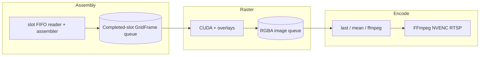
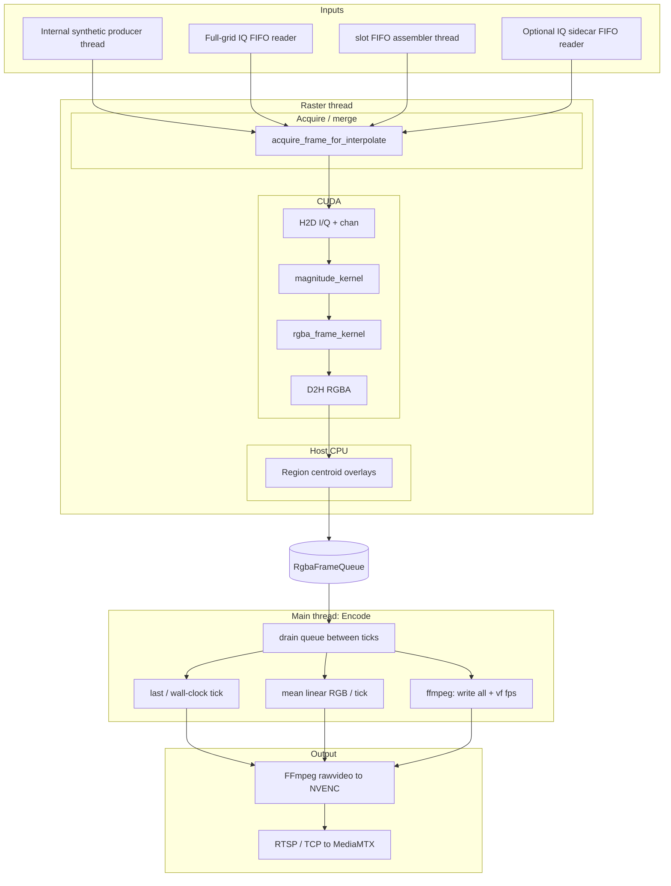

# `resgrid_plotter` — processing pipeline

This document describes the **end-to-end data path** inside **`resgrid_plotter`** (sources: `backend/resouce-grid-plotter/src/plotter_{management,assembly,raster,encode}.cu` and `include/plotter_common.cuh`): how grids are produced or ingested, how they become RGBA, how frames are selected for NVENC, and how the FFmpeg child is configured.

**Related docs:** stack roles and env in [`ARCHITECTURE.md`](ARCHITECTURE.md); slot FIFO wire format and **`slot_id`** semantics in [`CHANNEL_BASED_INTERFACE.md`](CHANNEL_BASED_INTERFACE.md).

---

## 0. Target architecture: Assembly, Raster, Encode (design)

This section names the three concerns: **Assembly** (complete **`GridFrame`** per slot or full-grid tick), **Raster** (grid → RGBA + overlays), **Encode** (RGBA stream → NVENC/RTSP with **`--encode-policy`**). The split sources implement **Raster** on a **background thread** (**`raster_stage_main`** in **`plotter_raster.cu`**) and **Encode** on the **main thread** (**`plotter_management.cu`**), with a **`RgbaFrameQueue`** between them; **Assembly** runs in **`plotter_assembly.cu`** threads plus **`acquire_frame_for_interpolate`** inside **Raster**.

### 0.1 Assembly (resource grid assembly)

**Role:** Consume **slot FIFO** messages (and, in combined setups, any **slot-boundary** semantics agreed with the producer) and build **one complete per-slot resource grid** per logical slot.

- **Input:** Slot records (`SlotMsgHdr` + optional regions / I/Q payload); see [`CHANNEL_BASED_INTERFACE.md`](CHANNEL_BASED_INTERFACE.md).
- **Output:** A **`GridFrame`** (full **`prb × symbols`** **`iq`**, **`chan`**, **`cell_rnti`**) that represents **one completed slot**.
- **Queue:** Push completed **`GridFrame`** instances into a **completed-slot queue** (**drop oldest** when full; see §6).
- **“All messages for a slot”:** The assembler **must not** finalize slot **N** until every patch for **N** has been applied (under the usual contract: **monotonic `slot_id`** on the wire; the producer emits **all** records for slot **N** before any record with **`slot_id > N`**). If the producer can reorder or split slots across writers, completion rules need to be explicit (out of scope here).

**Non–slot-message paths (modes 1 and 2):** Treat each **already-complete** grid (internal synthetic tick, or one **full-grid IQ FIFO** read) as a **degenerate** “slot completion” of one message → one **`GridFrame`** pushed onto the **same** completed-slot queue *or* a parallel **full-grid queue** that **Raster** merges with the same code path (implementation choice).

**Sidecar IQ (`--iq-fifo` in mode 3):** **Assembly** still owns **`chan` / RNTI`** for slot-derived grids; sidecar items remain **I/Q-only** updates. **Raster** can combine “last completed slot metadata + sidecar **`iq`**” before CUDA (same semantics as today’s **`pop_merged_assembled_or_sidecar_iq`**).

### 0.2 Raster (grid → image)

**Role:** Turn **each completed resource grid** into one **RGBA bitmap** (plus any **CPU overlays** that belong to that image).

- **Input:** **`GridFrame`** from the completed-slot queue (or equivalent).
- **Processing:** CUDA magnitude + Viridis / PHY tint (**`rgba_frame_kernel`**), D2H, then **optional centroid labels** on the host buffer.
- **Output:** A **finished RGBA frame** (host memory), suitable as one **encoder input image**.
- **Queue:** **`RgbaFrameQueue`** — bounded **drop-oldest** **`push`** when full (capacity **`--queue-depth`**), consumed by **Encode** on **`main`** (same policy as other **`GridFrame`** queues).

**Throughput:** **Raster** may run **faster** than real-time video (many images per second); **Encode** decides what actually reaches NVENC.

### 0.3 Encode (images → video)

**Role:** Consume the **image stream** and write **H.264** to RTSP via FFmpeg/NVENC at the configured output cadence (**`--encoder-fps`** / **`CUDA_IQ_FPS`**).

**Policies** (unchanged intent vs today’s **`--encode-policy`**):

| Policy | Behavior |
|--------|----------|
| **`last`** | On each encoder tick, send the **latest** RGBA produced since the previous tick (**last sample wins** / temporal subsampling). |
| **`mean`** | On each tick, output one RGBA whose pixels are the **average color in linear sRGB** over all images produced in that interval (alpha: mean of inputs). |
| **`ffmpeg`** | Write **every** image to FFmpeg rawvideo at the **pipeline** rate; FFmpeg **`fps=`** filter reduces to **`--encoder-fps`** before NVENC; idle paths may still duplicate frames for RTSP keepalive. |

Details and FFmpeg argv: **section 7** below.

### 0.4 Target flow (mermaid)

### 0.5 Implementation status

**Today (split `plotter_*.cu`):** **Assembly** — **`slot_message_assembler_main`**, **`external_grid_frame_reader_main`**, **`run_internal_synthetic_producer_loop`** → **`GridFrame`** queues (**`AssembledSlotQueue`**, **`GridFrameQueue`**). **Raster** — thread **`raster_stage_main`** (or pool): **`acquire_frame_for_interpolate`** (merged slot / sidecar), **`render_frame_rgba`**, then **`RgbaFrameQueue::push`**. **Encode** — **`main`** thread: drain **`RgbaFrameQueue`**, apply **`--encode-policy`**, **`write_rgba_to_ffmpeg`**. Bounded queues use **drop-oldest when full** (§6).

---

## 1. Overview

**Current implementation:** the diagram below matches the **Raster** / **`main`** split across **`plotter_raster.cu`** and **`plotter_management.cu`**. Sections **2–12** describe data shapes and FFmpeg in more detail.

At a high level: **one `GridFrame`** (per-cell complex I/Q + optional **`chan`** / **`cell_rnti`**) is **merged and acquired on the Raster thread**, **CUDA** turns it into a full-size **RGBA** bitmap, **CPU** may draw PHY labels, then **RGBA packets** cross **`RgbaFrameQueue`** to **`main`**, where an **encode policy** decides **when** and **what** RGBA is written to **FFmpeg stdin**; FFmpeg runs **`h264_nvenc`** and publishes **RTSP**.

---

## 2. Data modes (`--data-mode`)

| Mode | FIFOs | Producer / reader |
|------|--------|-------------------|
| **1** | None | In-process **`InternalFrameQueue`** filled by **`run_internal_synthetic_producer_loop`** (rate influenced by **`--fps`** and optional **`--cuda-shm`** command bytes). |
| **2** | **`--iq-fifo`** required | **`external_grid_frame_reader_main`**: each read = one complete **`prb × symbols`** **`float32`** I/Q raster; **`chan`** zero unless slot path also active (not typical for pure mode 2). |
| **3** | **`--slot-fifo`** required; **`--iq-fifo`** optional | **`slot_message_assembler_main`** builds full grids from slot records → **`AssembledSlotQueue`**. Optional sidecar IQ reader → **`ChannelModeIqSidecarQueue`**. |

**Acquire priority (mode 3):** **`pop_merged_assembled_or_sidecar_iq`** — try completed **slot** grid first; else try **sidecar IQ**; else short waits on each. Sidecar frames reuse the **last completed slot’s** **`chan` / `cell_rnti`** so the video does not alternate PHY tint vs Viridis when IQ arrives faster than slot boundaries.

**Defaults if flags omitted:** both FIFOs set → **3**; IQ only → **2**; slot only → **3**; neither → **1**.

---

## 3. Frame acquisition → `GridFrame`

- **`GridFrame`**: **`iq`** (`float2` per cell), **`chan`** (`uint8_t` per cell), **`cell_rnti`** (`uint32_t` per cell, slot path).
- **Blocking timeouts** on FIFO pops (internal / full-grid paths): **2000 ms** in **`acquire_frame_for_interpolate`** (called from **`raster_stage_main`**) so the **Raster** thread can yield while waiting for grids; **Encode** applies mode-3 idle / encoder timing separately.

---

## 4. CUDA rasterization (`render_frame_rgba`)

1. **H2D:** complex **`iq`**, **`chan`** plane, and per-cell **`cell_rnti`** (zeros filled when absent) to device.
2. **`magnitude_kernel`:** per-cell magnitude from complex samples.
3. **`rgba_frame_kernel`:** maps the **resource grid** (PRB × symbol) into the **output frame** using **`--cell-pixels`**, optional **square canvas** / **letterbox**, and **`--mag-scale`**. Where **`chan == 0`**, color follows **Viridis** on magnitude; for **`chan` in `1…8`**, a **PHY tint** is used (**`channel_tint_modulated`**: base palette per id plus a subtle deterministic jitter from **`cell_rnti`** when non-zero; magnitude is not used for those cells).
4. **D2H:** full **`frame_w × frame_h × 4`** RGBA to host **`h_rgba`**.

**Geometry:** NVENC may require minimum dimensions and **16-pixel** alignment; the plotter **pads** toward **≥128** on each side and **centers** content when padding (see comments in `main()` around **`kNvencMinDim`** / **`align_up_16`**).

---

## 5. Host overlays (CPU, after D2H)

If any **`chan`** value is in **`1…8`**, **`overlay_chan_region_borders_on_rgba`** draws dark outline strokes on PHY region edges (same **chan** / **`cell_rnti`** merge rule as labels; stroke width 1–3 px from content scale), then **`overlay_chan_region_labels_on_rgba`** draws centroid labels. Pure magnitude grids (**all `chan` zero**) skip overlays.

---

## 6. In-memory queues (backpressure)

| Queue | Capacity | `push` when full |
|--------|----------|------------------|
| **`InternalFrameQueue` / `FullGridFifoQueue` / `ChannelModeIqSidecarQueue`** (`GridFrameQueue`) | **`--queue-depth`** (default **32** from **`CUDA_IQ_QUEUE_DEPTH`**) | **Drops oldest** `GridFrame`, increments **`g_grid_frame_queue_drops`** (never blocks the producer on backlog). |
| **`AssembledSlotQueue` (`SlotCompletedQueue`)** | **`--queue-depth`** (same as **`GridFrameQueue`** / **`CUDA_IQ_QUEUE_DEPTH`**) | **Drops oldest** completed grid, increments **`g_slot_completed_drops`**. |
| **`RasterWorkQueue`** (raster thread pool) | **`max(--queue-depth, 2 × raster_threads)`** | **Drops oldest** work item, increments **`g_raster_work_queue_drops`**. |
| **`RgbaFrameQueue`** (Raster → Encode) | **`--queue-depth`** | **Drops oldest** RGBA buffer, increments **`g_rgba_frame_queue_drops`**. |
| **`CapturerFrameQueue`** (Raster → JPEG file workers) | **`≥ queue-depth`** (see code / backend) | **Drop-oldest** when full, increments **`g_capturer_frame_queue_drops`**; **slow disk / JPEG** does **not** stall **Raster** or **NVENC**. |

All of the above keep the **newest** item after a drop. **`plotter_warn_queue_drop_oldest`** prints **`warning:`** lines to **stderr** when drops occur (at most about **one line per ~2.5 s per queue type**, mutex + steady clock so concurrent producers such as **Raster merger** do not spam identical lines). Each line names the **producer stage** (who called `push`) and the **queue**. **Raster pool merger** **`pending`** map is not a FIFO: it holds out-of-order CUDA results until **`next_merged_seq`** is available (unbounded only if workers diverge; not changed here).

So: under load, **oldest** assembled grids / RGBA copies may be discarded instead of blocking producers; **Encode** still reads the latest frames available in **`RgbaFrameQueue`**. Each accepted **capturer** frame still costs a **host memcpy** on the raster/merger path.

---

## 7. Encoder cadence and `--encode-policy`

Two rates matter:

| CLI | Typical env | Role |
|-----|-------------|------|
| **`--fps`** | **`CUDA_IQ_GEN_FPS`** | Nominal **pipeline** / producer / rawvideo **input** rate hint (especially for **`ffmpeg`** policy, capped **600** in FFmpeg spawn). |
| **`--encoder-fps`** | **`CUDA_IQ_FPS`** | Target **output** timeline (Hz); also drives **wall-clock** pacing for **`last`** / **`mean`**. |

If **`--encoder-fps`** is omitted on the CLI but **`--fps`** was set, **`--encoder-fps`** follows **`--fps`** (single-knob compatibility).

### 7.1 `last` (default)

- **Raster** produces RGBA whenever a **`GridFrame`** is merged (up to the pipeline rate) and **pushes** copies into **`RgbaFrameQueue`**.
- **Encode** (**`main`**) **drains** **`try_pop`** bursts between encoder ticks; on each **`1/encoder_fps`** tick it writes the **latest** RGBA dequeued for that interval (**temporal subsampling**, “latest wins”).
- **Counters:** **`g_stage_output_count_assembly`** +1 when **Assembly** pushes a completed **`GridFrame`** downstream; **`g_stage_output_count_raster`** +1 per **Raster** RGBA frame; **`g_stage_output_count_encoder`** +1 per successful **complete** **`fwrite`** burst to **Encode** (see §8 — stdin writes **loop** until the full RGBA size; partial pipe writes would corrupt **rawvideo**). A dedicated stats thread samples **Δcount/Δt** (~1 s) for SHM/API Hz.

### 7.2 `mean`

- **Encode** **drains** all **`RgbaFrameQueue`** packets between ticks; for each popped RGBA it accumulates **per-pixel** sums of **linear** R/G/B (sRGB **EOTF**), and sums of **alpha** bytes.
- On each tick, output **linear average → sRGB OETF** per channel; alpha = **rounded mean** of input alphas.
- Idle ticks with **no** new RGBA still **duplicate** the last encoded frame if needed (same RTSP keepalive idea as **`last`**).

### 7.3 `ffmpeg`

- **Encode** **writes every** RGBA **immediately** as **Raster** pushes it (same high-rate stdin behavior as before the thread split).
- Child process: **rawvideo** **`rgba`**, **`-r min(600, --fps)`** on stdin, then **`-vf fps=encoder_fps:round=floor`**, then **`h264_nvenc`** → RTSP.
- **Idle (mode 3, no new grid):** still emits **duplicates** at **`encoder_fps`** so MediaMTX does not time out on an empty stdin (see comments above the main loop).

---

## 8. FFmpeg / NVENC child

**Spawn:** **`spawn_ffmpeg_nvenc_rtsp`** — **`pipe()` + `fork()`**, child **`dup2`** stdin, **`execlp("ffmpeg", ...)`**.

- **Without** **`-vf`**: rawvideo **`-r`** = **`encoder_fps`** (matches **`last`** / **`mean`** pacing).
- **With** **`-vf fps=…`**: rawvideo **`-r`** = **pipeline** rate; filter enforces **`encoder_fps`** before NVENC.
- **Video:** **`h264_nvenc`**, **`yuv420p`**, **GOP** ≈ **`max(encoder_fps/2, 30)`**, **`-forced-idr 1`**, **RTSP over TCP**.

**Stdin writes:** **`write_rgba_to_ffmpeg`** sends exactly **`rgba_bytes`** per logical frame using **`write(2)`** on the pipe fd (no stdio buffering / per-frame **`fflush`**). Short writes are **looped** until the full frame is delivered or I/O fails; **`nbytes ≠ rgba_bytes`** is rejected so **FFmpeg** never sees a truncated **rawvideo** packet. On failure, **`g_run`** is cleared so threads drain cleanly (covers **EPIPE** when FFmpeg exits and **allocation** / resource pressure).

**Progress:** FFmpeg **stderr** **`fps=`** reflects **stdin** frame rate; with **`last`/`mean`** it should track **`encoder_fps`** when pacing is steady.

---

## 9. Control shared memory (`--cuda-shm`)

The backend allocates a **`384`-byte** POSIX SHM object (`_IQ_CUDA_SHM_BYTES` in `backend/app/main.py`); the plotter **mmap**s it read/write (`kIqCudaShmBytes` in `plotter_common.cuh`). **Offsets 0…87** hold legacy FPS / pattern / pipeline stats; **88…383** hold **file capturer** session fields when **`--capturer-dir`** is used.

### 9.1 Pipeline stats (bytes 0–87)

| Offset (bytes) | Type | Writer | Meaning |
|----------------|------|--------|---------|
| **0** | `double` | Stats thread (mode **1**) | Measured internal **producer** Hz. |
| **8** | `double` | Stats thread | Measured **Raster** RGBA output rate (images/s); legacy API field **`iq_plotter_fps`**. |
| **16** | `uint32_t` | Reader of SHM / API | **Synthetic pattern id**; must match backend / generator (**`IQ_PATTERN_*`**). |
| **24** | `double` | Backend / tooling | **Commanded** producer Hz (clamped **1…600**); internal producer sleeps to this. |
| **32** | `uint64_t` | Plotter after each **complete** stdin write to FFmpeg | Cumulative **frames published** to NVENC stdin (same as **`g_stage_output_count_encoder`**). |
| **40** | `double` | Stats thread | **Assembly input** messages/s (slot records, IQ FIFO messages, or internal synthetic ticks). |
| **48** | `double` | Stats thread | **Assembly output** completed **`GridFrame`**/s pushed to internal queues. |
| **56** | `double` | Stats thread | **Raster input** (chained): same value as offset **48** — “input to Raster” = **Assembly output** Hz. |
| **64** | `double` | Stats thread | **Raster output** images/s (same rate as offset **8**). |
| **72** | `double` | Stats thread | **Encoder input** (chained): same value as offset **64** / **8** — “input to Encode” = **Raster output** Hz. |
| **80** | `double` | Stats thread | **Encoder output** frames/s (successful **`write_rgba_to_ffmpeg`**). |

The last pipeline **`double`** occupies bytes **80…87**; byte **88** begins the **file capturer** block (§9.2).

### 9.2 File capturer (bytes 88–383)

Little-endian **`uint32`** unless noted. Path is **256 bytes** UTF-8 (NUL-padded). FastAPI **arms** the session; the plotter **updates** counters and phase.

| Offset | Size | Meaning |
|--------|------|---------|
| **88** | 4 | Session **total** frames requested. |
| **92** | 4 | **Inflight** hint (queue depth + JPEG workers). |
| **96** | 4 | **Written** JPEG count. |
| **100** | 4 | **Phase** (idle / recording / flushing — see backend constants). |
| **104** | 256 | Output directory path for this session. |
| **360** | 4 | Capturer queue **depth** (observed). |
| **364** | 4 | Capturer queue **capacity**. |
| **368** | 4 | JPEG **worker** thread count. |
| **372** | 4 | **Stop** flag (backend requests early end). |

**OOM / resilience:** **`std::bad_alloc`** on capturer RGBA copies or **`RgbaFrameQueue`** push clears **`g_run`** (capturer may **`shm_abort`** and join workers) so torn **rawvideo** frames are not emitted; see **`plotter_capturer.cu`** and **`plotter_encode.cu`**.

---

## 10. CLI quick reference

| Flag | Purpose |
|------|---------|
| **`--rtsp URL`** | RTSP publish URL (default `rtsp://127.0.0.1:8554/live`). |
| **`--prb` / `--symbols` / `--cell-pixels`** | Grid dimensions and pixel stride. |
| **`--fps` / `--encoder-fps`** | Pipeline vs encode timeline (see section 7). |
| **`--encode-policy last\|mean\|ffmpeg`** | How pipeline RGBA maps to NVENC stdin (see section 7). |
| **`--mag-scale`** | Magnitude scaling into colormap. |
| **`--preset`** | NVENC preset (e.g. **`p4`**). |
| **`--queue-depth`** | **`GridFrameQueue`** capacity (not slot queue). |
| **`--data-mode 1\|2\|3`** | Pipeline selection (see section 2). |
| **`--iq-fifo` / `--slot-fifo`** | Named pipe paths. |
| **`--cuda-shm NAME`** | SHM object name for section 9. |
| **`--capturer-dir DIR`** | Optional root for **JPEG** still capture (**`frame_*.jpg`**); arms via SHM §9.2 / FastAPI. |
| **`--no-square` / `--square-letterbox`** | Layout modes. |

**Backend:** passes **`CUDA_IQ_GEN_FPS`**, **`CUDA_IQ_FPS`**, **`CUDA_ENCODE_POLICY`**, dimensions, FIFO paths, **`--cuda-shm`**, and **`--capturer-dir`** when **`RESGRID_CAPTURER_DIR`** (or legacy snap dir) is set when spawning the binary (`backend/app/main.py`).

---

## 11. Shutdown

Stopping the process sets **`g_run`**; threads drain. The slot assembler **finalizes** the open slot on FIFO close. **`fclose`** FFmpeg stdin; child is **SIGTERM**’d then **`waitpid`**.

---

## 12. Source map

Shared types, queues, SHM helpers, and cross-stage declarations: **`include/plotter_common.cuh`**.

| Concern | Primary file |
|---------|----------------|
| Process globals, **`FpsShmMap`**, CLI, **`main()`**, stats thread, encode pacing (last / mean / ffmpeg), shutdown | **`src/plotter_management.cu`** |
| Slot FIFO assembly, **`active_slot`**, finalize, IQ readers, internal synthetic producer | **`src/plotter_assembly.cu`** |
| CUDA kernels, overlays, merge/acquire, **`render_frame_rgba`**, **`raster_stage_main`** | **`src/plotter_raster.cu`** |
| **`spawn_ffmpeg_nvenc_rtsp`**, **`write_rgba_to_ffmpeg`** | **`src/plotter_encode.cu`** |
| File capturer (**JPEG** queue, SHM §9.2) | **`src/plotter_capturer.cu`** |
| sRGB linear mean helpers | **`plotter_management.cu`** (used by **`main()`** mean path) |
